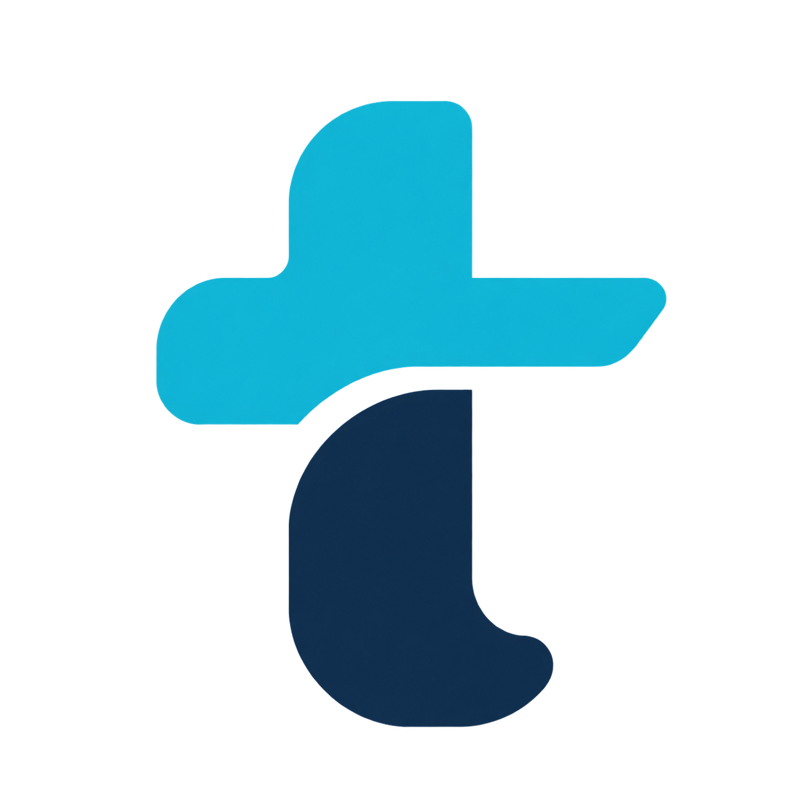

<p align="center"></p>
<h1 align="center">Taavod</h1>
<p align="center">A private workspace for learning BI skills, practicing with real data, and preparing for the next role.</p>
<p align="center">
  
  
  
  
</p>
<p align="center"><a href="#about">About</a> · <a href="#features">Features</a> · <a href="#tech-stack">Tech Stack</a> · <a href="#getting-started">Getting Started</a> · <a href="docs/SETUP.md">Setup guide</a></p>

## About

Taavod connects practice to evidence and job requirements. It keeps imported experience separate from demonstrated proficiency, automated checks separate from self-review, and historical job leads separate from current vacancies.

Hen's private installation targets BI Developer and BI Engineer roles across Israel, prioritizes AI companies, and works toward February 2027 with four weekly hours by default. A reusable onboarding flow supports a fresh profile without inheriting Hen's data.

The backend runs locally in Supabase containers managed by OrbStack. SQL and Python exercises execute in disposable browser workers, independently of the application database. The approved clay portrait keeps Hen’s haircut and face intact. PixiJS renders facial layers, while Bloub’s engine drives gaze, blinks, expressions and transitions.

A separate file-backed development mode is retained for troubleshooting; it is disabled in production.

## Features

| Area | Included |
|---|---|
| Today | Weekly tasks, capacity, due reviews, follow-ups and target date |
| Learn | 10 tracks, 30 guided lessons, worked examples, interactive join illustration and official resources |
| Practice | 81 exercises; PostgreSQL, Python/pandas, quizzes, written rubrics and external BI assignments; CodeMirror SQL editor, visual schema and a 121,209-row Pagila exploration database |
| Verification | Two-fixture code checks, hints, confidence, diagnostic resume, reset/cancel and spaced review |
| Jobs | Historical imports, Tavily search, Greenhouse/Lever feeds, URL/text/manual capture, deduplication and application stages |
| Portfolio | Project evidence, status, interview stories, checklists and private CV/file versions |
| Interviews | Timed drills, self-review criteria and saved preparation notes |
| Coach | Persistent corner window, expanded chat, live Claude/Groq model picker, contextual conversations, streamed responses and usage totals |
| Personal setup | Onboarding, profile notes, preferences, dark mode, private uploads and JSON export |

Power BI assignments use the actual external tool. Qlik exercises cover concepts and scripts. Written assignments use explicit self-review; the app does not claim to execute DAX or Qlik. Python downloads a pinned runtime and packages on demand, so it needs internet access.

Live AI and web search require personal API keys entered in Settings. A missing connection never produces a fabricated response or vacancy.

## Tech Stack

| Layer | Technology |
|---|---|
| Application | Next.js App Router, React, TypeScript |
| Interface | shadcn/Radix, Tailwind, Lucide, next-themes |
| Private data | Supabase Postgres, Auth and Storage with owner policies |
| Local services | Supabase CLI, Docker, OrbStack |
| SQL runtime | PGlite WebAssembly in a browser worker |
| Python runtime | Pyodide, pandas and matplotlib in a browser worker |
| AI | AI SDK with direct Anthropic and Groq providers |
| Checks | Vitest, TypeScript, ESLint and Playwright CLI |

## Getting Started

Requirements: Node.js 24, pnpm 12, Supabase CLI, and Docker through OrbStack or another Docker runtime.

```sh
pnpm install --frozen-lockfile
pnpm services:start
pnpm local:setup
pnpm dev
```

Open [Taavod](http://127.0.0.1:3100). Sign-in email is captured by the [local inbox](http://127.0.0.1:55324). The private database survives service restarts.

For this installation, `local:setup` loads the approved career material from the local Career folder. Personal records and uploaded files are never copied into public assets. Read [the setup guide](docs/SETUP.md) for a fresh installation, service ports, migrations, and future hosting.

### Scripts

| Command | Purpose |
|---|---|
| `pnpm dev` | Start the app on loopback port 3100 and prepare SQL runtime assets |
| `pnpm services:start` | Start the dedicated local Supabase stack |
| `pnpm services:stop` | Stop this stack while retaining data |
| `pnpm services:status` | Show service health and URLs without printing keys |
| `pnpm local:setup` | Configure local environment, create the owner, import private records |
| `pnpm import:career` | Import into file-backed development storage |
| `pnpm import:career --supabase` | Import into configured Supabase, preserving existing records |
| `pnpm typecheck` | Generate route types and check TypeScript |
| `pnpm lint` | Check authored source; exclude generated runtime assets |
| `pnpm test` | Run grading, isolation, validation and integration tests |
| `pnpm build` | Prepare runtime assets and produce the production build |
| `pnpm start` | Serve the production build |

### Further reading

- [Setup and operation](docs/SETUP.md)
- [Architecture and data boundaries](agent_docs/architecture.md)
- [Verification workflow](agent_docs/verification.md)
- [Learning workbench and product references](docs/LEARNING-WORKBENCH.md)
- [Avatar library research](docs/AVATAR-REVIEW.md)
- [Third-party notices](docs/THIRD_PARTY_NOTICES.md)

This is a private personal project. No open-source license is granted for the application.
